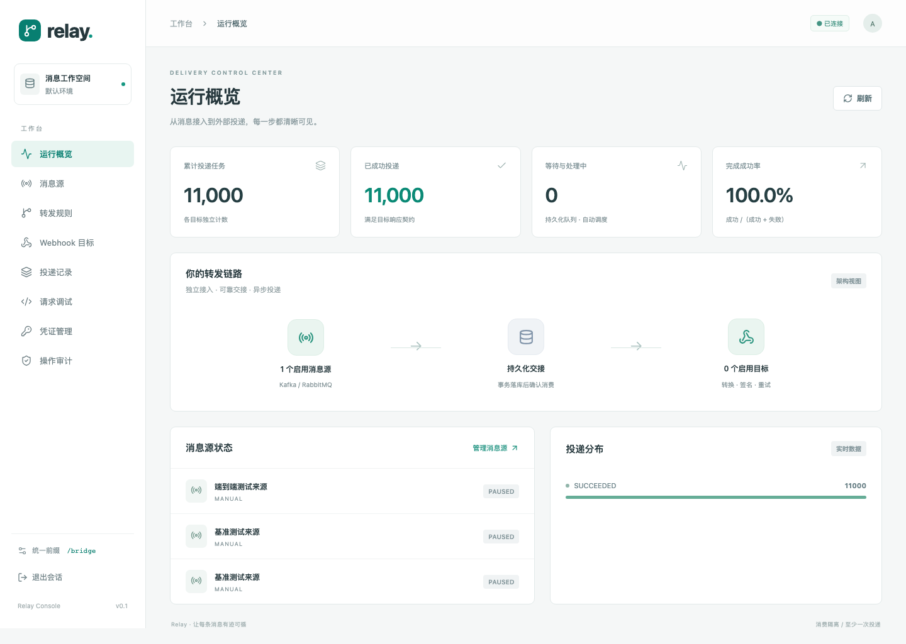
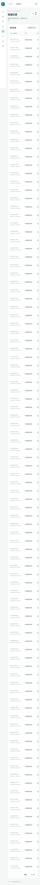

# 实现与验证记录

日期：2026-11-10。验证发生在当前macOS arm64开发机，不是生产SLA认证。

## 已执行的验证

| 项目 | 结果 |
|---|---|
| Go编译、go vet | 通过 |
| Go race测试，真实PostgreSQL | 通过，16项测试，无跳过的数据库/Broker测试 |
| 真实Kafka 4.4.0 | 独立业务消费组与平台组均读取完整5条消息 |
| 真实RabbitMQ 4.4.0 | 平台副本队列接收5条，原业务队列完整保留5条 |
| PostgreSQL 17 | 事务去重、目标快照、并发领取、租约恢复、重放通过 |
| 503后重试成功 | 通过，逻辑任务最终成功、实际HTTP调用2次 |
| 保留清理 | 成功任务与原文可清理，30天去重标记仍有效，未完成原文保留 |
| 脚本 | 无限循环中断、上下文隔离、HMAC黄金样例通过 |
| HTTP安全 | 私有地址策略、禁止重定向、响应业务码判定通过 |
| 预览隔离 | OAuth鉴权链预览不读取真实凭证、不调用Token服务 |
| 外部连接器 | SDK构造请求可投递，越权改目标被拒，503进入重试 |
| 前缀bridge | 页面、深层刷新、API404和资源404通过 |
| Vue/TypeScript生产构建 | 通过，JS约122kB，gzip约46.6kB，CSS约12.8kB |
| Vitest | 2项测试通过 |
| Playwright Chromium | 登录、导航、预览、手动接收、投递详情、刷新通过 |
| npm audit | 零已知漏洞；仅代表运行时查询到的npm数据库结果 |

Go测试集：

```text
TestPrefixAndSourceIsolation
TestNetworkPolicy
TestRawBytesAndResponseContract
TestRedirectAndRetryAfter
TestTemplatePrecisionAndMissingField
TestScriptTimeoutAndIsolation
TestKafkaIndependentConsumption
TestRabbitIndependentQueue
TestInboxTransactionAndSnapshot
TestConcurrentClaimsAndRecovery
TestEncryptedCredentialAndSignature
TestHTTPPrefixAndAuthentication
TestDispatcherEndToEnd
TestRetentionPreservesDedupAndPending
TestPreviewNeverLoadsOAuthChain
TestExternalConnector
```

Broker测试证明消费语义隔离，不证明共享集群的业务延迟完全不受影响。

## 本地短时负载样本

链路：16并发HTTP生产者 → manual来源 → PostgreSQL事务 → 单目标HTTP Worker → 本机测试HTTP服务。单条JSON约950B，原文透传，无签名、无脚本、无故障重试；目标64并发、10000rps令牌桶，平台总并发256，持久化同步提交开启。

| 指标 | 1000条样本 | 10000条样本 |
|---|---|---|
| 接入耗时 | 0.198s | 1.747s |
| 接入到全部目标收到 | 1.062s | 2.751s |
| 样本平均完成速率 | 941.5条/s | 3635.5条/s |
| 端到端P50 | 870ms | 1362ms |
| 端到端P95 | 889ms | 1461ms |
| 端到端P99 | 923ms | 1464ms |
| 重复HTTP交付 | 0 | 0 |
| Go主进程采样峰值RSS | 未采样 | 34.7MiB |

端到端时间由生产者写入的sent_at到目标实际收到计算，包含排队及配置刷新生效的等待；完成速率以有限样本总耗时计算。目标收到时，最后几条成功状态可能仍在数据库提交，脚本不将接收端收到与所有状态完成混为原子事件。

**限制：**短时样本不能推导持续数小时吞吐或生产SLA；RSS不包含PostgreSQL、Kafka、RabbitMQ、操作系统缓存和子进程。该样本没有通过Kafka/RabbitMQ入口，也没有脚本、多目标、TLS、真实公网延迟或断网恢复，不能外推这些场景的容量。

## 与设计方案的实现对应

本版在同一事务内完成有界路由扇出，替代原方案独立FanoutJob的首期展开流程，保证落库失败不确认源消息。单活Dispatcher在本进程执行并发HTTP Worker；api和ingest可分进程，远程Worker协议未实现。

可靠状态由PostgreSQL维护；启动/接管根据未结束租约保守等待；网络结果未知通过Attempt.UNKNOWN和租约恢复表达。内部租约不能阻止已经到达远端的副作用，仍需目标幂等。

未完成的扩展能力和部署约束详见README“运行边界”。Docker文件尚未在Docker引擎运行；数据库HA切换、长稳压测、不可信脚本硬沙箱和各厂商SDK适配没有验证，不标记为已完成。

## 界面预览




