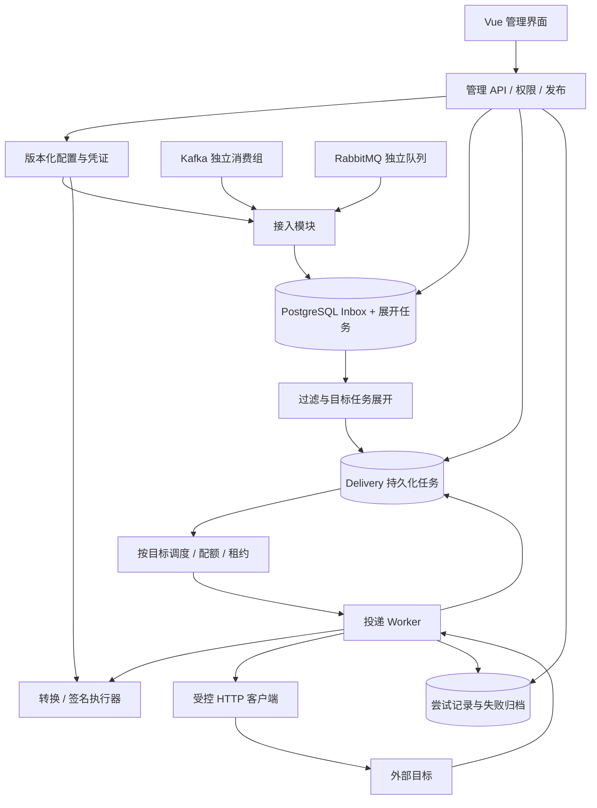
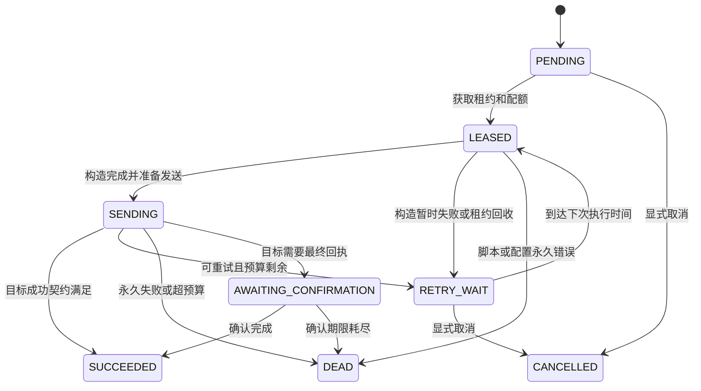

# 消息中间件 Webhook 转发平台：详细设计方案

版本：v1.0 设计基线  
日期：2026-11-10  
状态：可用于技术评审、任务拆分与原型开发；容量数字为待验证的设计输入，不代表性能承诺。

## 1. 目标、假设与边界

### 1.1 产品目标

构建有前后端的消息转发平台：独立订阅 Kafka、RabbitMQ，将消息按规则转换为目标所需的 HTTP/HTTPS 请求，支持鉴权、签名、脚本、限流、重试、查询、重放及审计。

核心目标：

1. 外部请求格式完全由目标配置与扩展逻辑决定，不强制包装为平台自定义 JSON。
2. Kafka 消费进度、RabbitMQ 队列与原业务隔离。
3. 消费接入和外部投递异步解耦；单目标异常不耗尽其他目标的资源。
4. 所有缓存和并发有上限；积压进入持久化存储。
5. 同一配置项派生页面与 API 前缀。
6. 从小规模部署起步，能够按接入、调度、投递角色扩容。

### 1.2 默认假设与待确认项

| 项目 | 本方案默认值/处理方式 | 上线前需确认 |
|---|---|---|
| 部署环境 | Linux 容器或 Linux 主机，开发环境可使用 macOS | CPU、内存、磁盘、网络、容器平台 |
| 使用范围 | 单组织，预留 workspace_id 隔离字段 | 是否需要不可信租户、计费和强隔离 |
| 投递语义 | 至少一次尝试；成功取决于目标响应契约 | 是否允许重复、目标是否支持幂等 |
| 消息顺序 | 默认不保证；可选 Kafka 分区顺序 | 业务 Key 顺序是否必要 |
| 消息格式 | 原始字节、JSON、文本优先 | Avro/Protobuf 的 Schema 来源 |
| HTTP 接口 | 单次请求为默认；预留多步连接器 | 是否需要异步回执、专有 SDK |
| 可用性 | 单机版先完成能力；生产 HA 另行配置 | RPO、RTO、跨区要求 |
| 规模 | 不预设实际 TPS | 峰均速率、消息大小、目标扇出、接口耗时 |

### 1.3 不可省略的约束

- “支持任意 Webhook”指可配置和扩展的合法 HTTP/HTTPS 接口，不承诺通用配置自动支持验证码、浏览器交互或任意私有协议。
- 独立消费不等于零资源影响；同一 Broker 上的新增订阅仍产生磁盘、网络和 CPU 开销。
- 外部接口没有幂等或结果查询能力时，平台无法单方面保证业务效果恰好一次。
- 有限存储无法同时承诺无限期下游故障、无限持续流入、零丢失和零上游影响。
- 可靠性承诺以源端保留、内部持久化、容量、重试期限和灾备配置为前提。

## 2. 总体架构与选型

### 2.1 推荐技术栈

| 层次 | 选择 | 说明 |
|---|---|---|
| 后端 | Go，选择开发时仍受支持的稳定版本并锁定 | 网络 I/O 并发、单程序部署、便于资源治理 |
| 管理 API | net/http + 轻量路由库（如 chi） | 路由库不决定总体吞吐，优先正确超时与访问控制 |
| HTTP 投递 | net/http，自定义 Transport 配置 | 复用连接；支持 TLS、代理、HTTP/2，按目标兼容性选择 |
| Kafka | franz-go 候选 | 需对目标 Broker、认证方式和再均衡场景验证 |
| RabbitMQ | rabbitmq/amqp091-go 候选 | 首期明确支持 AMQP 0-9-1，不混称所有 AMQP 协议 |
| 持久化 | PostgreSQL + pgx | 配置、Inbox、任务、尝试记录、租约、审计 |
| 前端 | Vue 3 + TypeScript + Vite | 静态构建；可嵌入 Go 程序 |
| 脚本 | 独立受限进程中的 Goja | 非完整 Node.js；需要硬隔离时由 OS/容器限制 |
| 可观测性 | Prometheus 格式指标、结构化日志，可选 OpenTelemetry | 不依赖监控组件才可运行 |
| 扩展协议 | 独立连接器，受控本地 RPC/HTTP | 为特殊 SDK、多步握手、重计算预留 |

不把 Redis、Elasticsearch、额外 Kafka、Kubernetes 设为首期必选。若容量验证要求专用队列或索引，再按实际瓶颈增加。

### 2.2 逻辑架构



### 2.3 进程角色

同一程序支持以下模式，保持模块接口稳定：

```text
relay all          # API + 接入 + 展开 + 调度 + 本机投递
relay api          # API 与前端静态资源
relay ingest       # Kafka / RabbitMQ 接入
relay dispatcher   # 展开任务、目标所有权、调度、租约恢复
relay worker       # 请求构造与 HTTP 投递
relay executor     # 独立脚本执行器
```

`all` 是低成本部署方式。生产 HA 可分别运行多副本；持久化任务是事实来源，进程内通知和数据库通知仅用于唤醒，丢通知不丢任务。

## 3. 核心领域对象与配置版本

| 对象 | 职责 |
|---|---|
| Source | Broker 连接、订阅、认证引用、接入状态、初始位置 |
| Endpoint | 目标网络策略、请求构造、鉴权、响应判断、容量限制 |
| Route | 来源、过滤、转换、目标绑定、顺序与重试策略 |
| SourceRevision / EndpointRevision / RouteRevision | 不可变的已发布配置 |
| SubscriptionSnapshot | 某来源当前生效的完整路由集合及其版本引用 |
| Event | 已被平台持久化接收的原始消息 |
| FanoutJob | 基于快照完成过滤和生成目标任务 |
| Delivery | 某条消息向某个目标的一次逻辑投递 |
| Attempt | 一次实际发送或发送前处理的执行记录 |
| CredentialVersion | 受权限保护的密钥、证书和 Token 配置 |
| ReplayJob | 有范围、速率和审计信息的重放作业 |

关系：`Source → Event → FanoutJob → 多个 Delivery → 多个 Attempt`。

同一来源默认只读取一份消息，平台内部按路由扇出，避免每增加一个 Webhook 就新建一套 Broker 消费。

发布流程：草稿 → Schema 校验 → 编译模板/脚本 → 样例验证 → 生成不可变版本 → 原子更新生效快照 → 审计。失败不改变当前生效版本。

版本采用“平台接收时生效”的语义，不以消息生产时间决定。接入批次绑定一个快照；同一记录重复接收命中原 Event 时继续使用原快照。若要求精确到 Kafka Offset 的切换，需增加分区切换屏障，作为单独能力。

Endpoint 网络与模板默认按版本固定，防止积压消息突然改发其他地址。紧急停用、凭证撤销和安全网络策略属于实时覆盖项，必须立即生效。普通凭证轮换保留旧版本到在途任务完成；强制撤销则停止相关任务并告警。

## 4. 消息源接入

### 4.1 Kafka

连接配置包含：Bootstrap Servers、TLS/SASL、凭证引用、Topic 列表/受限模式、消费组、起始策略、抓取字节预算、事务隔离级别。

平台消费组使用专用命名空间，例如 `relay.<workspace>.<source>`，在创建后保持稳定。平台多接入实例使用同一来源消费组，不为每个实例生成新组；不同平台来源若都要完整消息，应各用独立组。

要求：

1. 禁止使用业务组；专用账号通过 Broker ACL 限制 Topic 和 Group。管理界面的命名前缀校验只是辅助防线。
2. 关闭自动提交。记录及展开任务持久化后，按分区提交安全位置。
3. 一个分区中的记录按读取顺序持久化，或跟踪已完成前缀；不能提交越过未持久化记录的位置。
4. Offset 可能不连续。安全前缀依据实际已读取记录顺序确定，不等待不存在的整数 Offset。
5. 重复入库用唯一键消除；提交失败允许重新读取，不先提交再补写。
6. 达到缓存字节预算时 pause 对应分区，并维持客户端要求的组管理；恢复后 resume。
7. 再均衡时停止领取已撤销分区的新记录，只提交已安全持久化的边界；不依赖 HTTP 发送完成。
8. 首次订阅支持 latest、earliest、timestamp。恢复使用已提交位点；位点过期默认进入错误状态并告警，不自动跳到最新。
9. 事务消息可配置 read_committed，避免转发未提交或回滚的数据。
10. 读取并行度受分区数约束；投递并发可以独立增加。

Kafka 官方对消费组、位点、手动提交、暂停和再均衡的说明是此部分实现依据：[KafkaConsumer](https://kafka.apache.org/41/javadoc/org/apache/kafka/clients/consumer/KafkaConsumer.html)。这里引用的是消费语义，具体 Go API 以锁定版本客户端为准。

### 4.2 RabbitMQ

首选结构：业务 Exchange 分别绑定原业务 Queue 和平台专用 Queue。平台只消费自己声明或经管理员明确授权的专用队列，不清空、删除或改变业务队列参数。

创建前先检查：Exchange 类型、Routing Key、Headers 绑定条件、持久性、队列类型、权限及源消息投递模式。

- 普通 direct/topic/fanout/headers 按匹配规则复制消息；特殊分配型 Exchange 必须单独评估。
- 默认 Exchange 向指定队列发送的场景，不能直接新增普通绑定获取完整副本。界面必须显示“需要调整源发布拓扑”，不能假装支持。
- 已从原队列确认移除的历史消息无法通过新建队列回溯。
- 源端消息是否能跨 Broker 故障保留，还取决于生产者持久化/确认及队列复制配置，平台不能补偿接入前已丢失的数据。

消费策略：手动 ACK；按条数和字节控制预取；入库事务成功后 ACK。入库失败停止扩大未确认集合，按退避恢复，避免无限 nack/requeue 热循环。

平台队列默认 durable、非 exclusive、非 auto-delete；生产需要 Broker 节点故障下可靠性时选择符合源版本的复制队列配置（如 quorum），并计入副本成本。单节点 durable 队列不等同于节点级高可用。管理 API 的队列深度查询使用单独的只读授权，不为基础消费索取管理员账号。

Delivery Tag 只在 Channel 内有效，不作为全局消息 ID。批量 ACK 仅确认同一 Channel 上已连续持久化完成的交付。

重连执行退避、重新订阅和明确的拓扑恢复。队列参数冲突显示为配置错误，不通过删除重建解决。依据：[RabbitMQ 消费确认](https://www.rabbitmq.com/docs/confirms)、[发布订阅](https://www.rabbitmq.com/tutorials/tutorial-three-go)。

### 4.3 原业务影响控制

| 隔离层级 | Kafka | RabbitMQ |
|---|---|---|
| 消费语义 | 独立 Group 和 Offset | 独立 Queue |
| 资源治理 | 客户端读取限制、Broker 配额 | 专用队列预算、连接和预取控制 |
| 强隔离 | 受控复制到独立集群 | 受控复制到独立 Broker/集群 |

任何新增复制仍有成本。强隔离要求必须明确允许修改哪些源端设施。

RabbitMQ 队列达到上限后的策略必须显式选择：`reject-publish` 可能影响发布确认；丢弃或过期策略牺牲转发完整性。不得默认配置后仍宣称“绝对不影响业务且绝对不丢”。参见：[队列长度限制](https://www.rabbitmq.com/docs/maxlength)。

## 5. 消息模型、入库与扇出

### 5.1 内部消息契约

```json
{
  "event_id": "平台生成的唯一 ID",
  "source_id": "src_orders",
  "source_epoch": "source_generation_1",
  "source_type": "kafka",
  "received_at": "2026-11-10T08:00:00Z",
  "snapshot_id": "snapshot_42",
  "raw": {"encoding": "base64", "data": "..."},
  "metadata": {
    "topic": "orders", "partition": 2, "offset": "123456",
    "key_base64": "...",
    "headers": [{"name": "trace-id", "value_base64": "..."}]
  }
}
```

这是管理 API/脚本传输示意，数据库原文用 `bytea`，不为存储额外 Base64。Headers 用列表保留重名与原始字节。Offset 和可能超出 JavaScript 安全整数范围的值使用字符串。JSON 解码要保留大整数精度；脚本不自动将所有数字转成浮点。

消息体仅存一份；Delivery 引用 Event。大对象扩展存储在首期之外，启用前需设计对象写入完成、DB 事务引用和孤儿清理，不能依赖不可靠的双写。

### 5.2 接入事务

```text
读取受限大小批次
→ 确定当前已发布快照
→ BEGIN
→ 写 Event（Kafka 按源位置去重）
→ 为新 Event 写 FanoutJob
→ COMMIT（要求持久化成功）
→ 源端提交/ACK
```

Event 和 FanoutJob 必须同事务。数据库同步提交不可为追求吞吐随意关闭。批量数量与最大等待时间共同限制，兼顾延迟和写放大。

超大消息或格式异常不能静默 ACK 后丢弃。原始消息可被可靠隔离时，持久化原文和原因后确认；超过平台可靠存储能力时暂停来源并告警，由明确策略处理。

### 5.3 可靠扇出

FanoutJob 根据固定快照执行解码、过滤和确定性的路由转换，再生成每个目标的 Delivery。唯一键包含 `(event_id, route_revision_id, binding_id)`，多次执行不生成重复逻辑任务。

目标较少时，任务生成与 FanoutJob 完成标记同事务；目标很多时分批生成，记录展开游标，每批提交，完成全部绑定后才标记完成。过滤、映射或解码失败必须进入可修复状态，不能当作“没有匹配目标”。

过滤为 false 是正常跳过，记录规则命中统计；异常是失败，两者区分。

首期不向脚本开放按消息内容返回无限目标列表。动态目标必须落在已授权 Endpoint/绑定和扇出上限内。

### 5.4 去重与保留

- Kafka 去重键：`source_id + source_epoch + topic + partition + offset`；Topic 重建或换集群时变更 epoch。
- RabbitMQ 只有在生产者承诺 Message ID 在指定范围内唯一时才启用接入去重；不能按内容哈希去掉合法重复事件。
- RabbitMQ 无稳定 Message ID 时，ACK 丢失窗口可能形成不同 Event；平台明确暴露这一限制，不能靠 Delivery ID 解决所有源端重复。
- 去重标记需要独立保留期限，不应随成功日志立即删除；超过期限的历史重读可能再次产生投递。
- 重放属于显式操作，使用 Replay ID 创建新任务，保留原 Event 引用，不能被正常接入去重误拦截。

## 6. 通用 HTTP 适配引擎

### 6.1 请求能力

| 部分 | 设计 |
|---|---|
| URL | 模板化路径与参数；保留重复 Query 参数；自定义编码需受限扩展 |
| Method | 标准合法方法，允许扩展合法 token；禁止原始报文注入 |
| Headers | 静态/表达式/脚本；支持多值；拒绝 CRLF 注入和非法传输字段 |
| Body | none、raw、JSON、text、XML、urlencoded、multipart、binary |
| 原文透传 | 直接使用原始字节，不解析再序列化 |
| 鉴权 | Basic、Bearer、API Key、OAuth2 client_credentials、mTLS；其他通过扩展 |
| 签名 | 可配置 canonical request、摘要编码、Header/Query/Body 落点 |
| 网络 | TLS 验证、受控 CA/客户端证书、代理、分阶段超时、重定向策略 |
| 响应 | 状态/头/体组合判断、脚本分类、正文读取上限 |

Host、Content-Length 等字段通过明确的 HTTP 客户端配置处理，不能把“任意 Header”解释为允许破坏协议。标准 HTTP 客户端不会保证 Header 大小写、顺序等原始线格式；依赖这些非标准行为的接口需要专用连接器。

### 6.2 执行阶段

```text
解码/过滤/业务转换（绑定版本）
→ 构造本次请求的路径、参数、Header、Body
→ 执行必要的预鉴权（缓存 Token）
→ 添加本次时间戳、Nonce、幂等标识
→ 规范化并计算签名
→ 冻结签名覆盖的请求内容
→ 网络策略校验与发送
→ 限量读取响应
→ 判定结果并持久化
```

签名后的 Body 字节不能再次 JSON 序列化；multipart boundary、压缩、Query 编码等在适当阶段固定。若协议需要签名后加密/封装，应由显式流水线或连接器表达，禁止隐式修改。

### 6.3 配置示例

以下为拟定的产品配置 DSL，不是某个现成库的语法；开发时需提供 JSON Schema 和表达式规范。

```yaml
name: partner-order-hook
request:
  method: POST
  url: https://partner.example.com/hooks/orders
  headers:
    Content-Type: application/json
  body:
    mode: json
    value:
      orderNo: {expr: "event.json.order_id"}
      amount: {expr: "decimal(event.json.amount).toFixed(2)"}
      eventType: paid
auth:
  type: hmac
  secret_ref: credential/partner-hmac/v3
  algorithm: sha256
  timestamp: {header: X-Timestamp, unit: seconds}
  canonical: "${attempt.timestamp}\n${request.body_sha256_hex}"
  output: {header: X-Signature, encoding: hex}
idempotency:
  header: Idempotency-Key
  value: "${delivery.idempotency_key}"
response:
  success:
    all:
      - status_in: [200, 201]
      - json_equals: {path: "$.code", value: 0}
limits:
  max_inflight: 16
  requests_per_second: 50
  burst: 50
timeouts:
  total: 10s
```

幂等 Header 只有目标明确支持时才启用。不得向所有第三方默认添加平台包装字段或未知 Header。

### 6.4 鉴权与连接器

Token 按凭证版本、Audience、Scope 缓存，提前刷新并加入随机抖动；同一刷新合并，刷新接口有独立并发/速率预算。401 后最多进行一次受控刷新重试，仍计入实际请求次数。

HTTP 202 默认仅代表按目标契约“已受理”。若需要最终结果，连接器进入 `AWAITING_CONFIRMATION`，保存远端任务 ID，按期限查询或接收带认证回调。未实现确认协议的目标不能在页面显示“业务已完成”。

扩展连接器使用版本化契约，提供构造/发送/判定能力；其副作用、请求数、超时和凭证访问纳入平台治理。不将自定义动态库直接加载进主进程。

## 7. 脚本执行与资源隔离

### 7.1 两类计算

1. 确定性业务阶段：filter、transform、canonicalize。输入为消息与版本化参数，不开放网络、系统时间或随机数；重试得到同样业务数据。
2. 尝试阶段：buildRequest、sign、classifyResponse。使用平台显式提供的本次时间戳、Nonce、Token 和请求上下文；不能悄悄改变已固定的业务数据。

复杂映射可保存转换产物，默认只固定原文与版本。若逻辑依赖外部可变数据，必须把查询结果作为持久化执行上下文，或者明确由多步连接器负责恢复。

### 7.2 拟定脚本接口

```javascript
// 由平台调用；并非直接运行 Node.js。
function buildRequest(ctx) {
  const body = ctx.codec.utf8Encode(ctx.json.stringify({
    orderNo: ctx.event.json.order_id,
    price: ctx.decimal(ctx.event.json.amount).toFixed(2)
  }));
  const digest = ctx.crypto.sha256Hex(body);
  const signature = ctx.crypto.hmacSha256Hex(
    "credential/partner-hmac/v3",
    ctx.attempt.timestamp + "\n" + digest
  );
  return {
    method: "POST",
    url: "https://partner.example.com/hooks/orders",
    headers: [
      ["Content-Type", "application/json"],
      ["X-Timestamp", ctx.attempt.timestamp],
      ["X-Signature", signature]
    ],
    bodyBytes: body
  };
}
```

宿主函数提供编码、摘要、签名、精确十进制、JSON/XML 工具。优先以密钥引用完成签名，不把密钥原文返回给脚本。确实要求读取密钥的扩展需要单独授权；隔离进程不能阻止被授权代码把密钥写进请求，因此脚本发布权限等同于敏感集成权限。

### 7.3 执行器约束

- 不暴露 `require`、任意网络、文件、进程和环境变量。
- 确定性阶段替换或禁止 Date、Math.random 等隐式非确定性入口；尝试阶段也只通过上下文取得时间和随机值，便于复现。
- 限制输入/输出大小、脚本源码大小、执行时间、执行队列和并发数。
- 编译产物按脚本摘要与引擎版本缓存；执行上下文隔离，不复用残留全局状态。
- 单个 Goja Runtime 同时只由一个执行流使用；不跨 Runtime 共享 JS 对象。
- 纯脚本超时可中断；宿主函数仍需自身可取消、输入有界。无法及时中断时终止执行器进程。
- 不可信代码强制在 OS/容器资源限制内执行。启用严格模式时，若环境无法建立限制则拒绝启动该模式。
- 进程池限制 CPU、RSS 和并发，不为每条消息启动新进程；异常执行器被回收后替换。
- 每个脚本绑定可用凭证、允许目标、宿主函数清单和版本。

Goja 的 Runtime 并发边界及中断能力参见：[Goja 官方文档](https://github.com/dop251/goja)。引擎可中断不代表具备每个脚本的硬堆内存配额。

## 8. Delivery 状态机与可靠恢复

### 8.1 状态定义



`SENDING` 租约过期时，Attempt 标记为 `UNKNOWN`，任务按至少一次策略进入重试；不能推断为“远端未执行”。`AWAITING_CONFIRMATION` 的查询由单独有租约的确认任务驱动，查询超时不直接重复创建远端业务。

FanoutJob 使用独立的 `PENDING/RUNNING/RETRY_WAIT/DONE/FAILED` 状态，保留过滤失败和展开失败的修复入口。

### 8.2 领取与完成协议

1. Dispatcher/Worker 用短事务批量领取当前到期任务，记录 owner、lease_token、lease_expires_at。
2. 事务提交后释放数据库锁，再执行脚本和网络请求；绝不持有行锁等待 HTTP。
3. 发送前持久化 Attempt 起始记录，产生固定 Attempt ID，随后开始网络 I/O。
4. 按需续租；租约失效后不发起新请求，取消可取消的在途操作。
5. 完成时以 Delivery ID 和 lease_token 条件更新任务，并持久化 Attempt 结果。
6. 旧 Worker 的迟到结果作为审计信息保存，但不能覆盖新租约状态。

请求发送与数据库状态不存在原子提交。即使有 lease_token，已经到达远端的旧请求也无法被数据库“撤回”；故障接管仍可能重复。目标幂等是解决业务重复的关键。

### 8.3 重试分类

| 情况 | 默认策略 | 可配置项 |
|---|---|---|
| DNS/连接/读取超时 | 重试并标记可能已执行 | 错误分类覆盖 |
| HTTP 429 | 遵守合法 Retry-After 并退避 | 最大等待、目标降速 |
| HTTP 408、部分 5xx | 重试 | 状态清单 |
| HTTP 400/403/404 等 | 默认归档 | 允许目标重定义 |
| HTTP 401 | 适用时受控刷新一次 | 刷新协议 |
| 2xx 业务错误 | 按目标业务码分类 | JSON/头/脚本规则 |
| 响应解析失败或超过上限 | 按契约归档/重试 | 必须显式选择 |
| 脚本编译、缺字段、非法 URL | 永久失败 | 修复后重放 |
| 凭证服务暂时不可用 | 限次重试 | 依赖故障预算 |

退避建议：`random(0, min(cap, base × 2^retry_index))`，同时设置最大实际尝试次数和最大投递年龄。建议起始默认 `base=1s、cap=5min、总尝试8次、最大年龄24h`；最大年龄是停止边界，不代表8次一定覆盖24小时。

所有真实网络调用计入请求指标。内部连接级重试和 Token 刷新不能形成不可见的额外洪峰。

### 8.4 重放、取消与暂停

- 重放创建新 Delivery，并关联原任务、Replay ID、操作者和原因，保留原尝试历史。
- 默认重放沿用原配置与幂等键，适用于补投；“按当前版本重新处理”必须明确选取版本和幂等策略，视为新业务尝试。
- 目标已撤销、凭证失效或原文已过期时禁止伪造成功重放，显示阻塞原因。
- 目标暂停：停止新调度，任务继续保留；来源暂停：停止新接入，已持久化任务继续处理，除非另外暂停目标。
- 停止来源、停止投递、取消积压是不同操作。取消已发送请求只能尽力而为，远端副作用不保证撤回。
- 重放采用独立速率预算和低于实时任务的默认优先级，避免抢占实时流量。

## 9. 调度、配额、顺序与背压

### 9.1 调度单位

先按租户/业务权重公平选择目标，再从目标领取一小批到期任务；使用加权轮询或 deficit round-robin。不能只扫全局最早的一批任务，否则故障目标会占满候选集合。

单机中 max_inflight 与 token bucket 限速同时生效。读取 Body、执行脚本、HTTP 在途分别占用独立的受限预算。

HTTP Transport 按 TLS/代理/证书策略键复用，缓存数量、空闲连接数和生命周期有上限；不能因动态 URL 无限创建 Client。不同逻辑 Endpoint 指向同一主机时还需主机级保护。

官方建议复用并发安全的 Client/Transport：[Go net/http](https://pkg.go.dev/net/http)。自定义 Transport 时显式验证 HTTP/2 配置、TLS 选项与协议兼容性。

### 9.2 多实例限制策略

首期采用 Endpoint 单活所有者：同一逻辑目标的任务统一由一个持租约的调度所有者控制总并发和速率，分配给其负责的执行 Worker。增加实例优先分摊不同目标，不能让每个实例分别获得完整目标配额。

需要跨 Endpoint 的租户/主机硬额度时，同一配额域由单一配额协调者授予有上限、短期限的执行许可；许可失效后不再开新请求。故障恢复保守等待旧许可和请求期限，不能立即重置全量额度。

目标所有者和执行任务均使用 epoch/租约；以数据库时间判定到期。因远端请求不可撤回，极端网络分区下无法把租约描述为绝对无瞬时超限。接管需保守冷却，并对超额监控。对硬性合同限流，保留额外安全余量或使用统一出站网关。

当单个热点目标超出单所有者能力时，后续扩展为多个配额分片并统一分配总额度；不能直接增加消费者后仍声称全局 QPS 不变。

### 9.3 顺序

首期支持 `none` 和 `kafka_partition`：

- `none`：允许并发和完成乱序。
- `kafka_partition`：同一 Source/Partition/Route/Endpoint 形成稳定 Lane，每次仅放行当前最早未完成任务。
- 规则版本变化不重置同一逻辑 Route/Endpoint 的 Lane，否则新旧任务可能交叉。
- 扇出需要分区顺序展开或维护展开水位，不能让后续事件先生成任务并抢先发送。
- 严格顺序下前序失败阻塞后续；跳过/取消前序必须审计，并明确改变连续交付语义。
- 不承诺跨 Kafka Partition、跨 Source 的全局顺序。

按业务 Key 的顺序涉及路由版本、分片键稳定性和跨分区排序，列为后续独立能力。RabbitMQ 普通队列在多消费者、重投等条件下不能简单宣称端到端严格顺序。

### 9.4 背压与熔断

背压链路：Worker 满 → 任务留在磁盘 → 内部容量达到阈值 → 接入降速/暂停 → 告警。所有批次同时受条数与字节数限制。

熔断按 Endpoint 统计连续/窗口失败，进入 open 后停止普通调度；half-open 仅放少量探测，恢复后逐步提升速率。限流响应和确定性业务错误分别统计，不全部作为网络熔断失败。

示例容量阈值为可配置运维起点：磁盘使用70%预警、80%限制低优先级重放、90%停止新接入并保留恢复写入空间。实际阈值要计入 WAL、临时文件和数据库维护空间，不以单一磁盘百分比替代容量模型。

## 10. PostgreSQL 数据模型与索引

### 10.1 主要表

所有业务表包含 workspace_id；敏感查询由服务层与必要的数据库策略共同约束。时间以 UTC 存储，界面按用户时区显示。

| 表 | 核心字段/职责 |
|---|---|
| sources / source_revisions | 来源标识、epoch、状态、连接配置版本、凭证引用 |
| endpoints / endpoint_revisions | 地址、网络策略、请求/响应规则版本、限额 |
| routes / route_revisions / route_bindings | 过滤转换、目标绑定和顺序策略 |
| subscription_snapshots | 来源当前路由集合，发布后不可变 |
| events | event_id、源位置、snapshot_id、raw bytea、元数据、保留期限 |
| source_dedup | 独立源位置/生产者唯一标识、event_id、到期时间 |
| source_checkpoints | 每个来源分区已安全持久化的位置，与接入批次同事务更新 |
| fanout_jobs | event_id、状态、展开游标、租约、错误、next_run_at |
| deliveries | 见下表 |
| delivery_attempts | attempt_id、Delivery、次数、lease_token、状态、耗时、脱敏响应摘要 |
| ordering_lanes | Lane、水位、阻塞任务、租约；只为顺序模式启用 |
| credentials / credential_versions | 加密数据、密钥版本、撤销状态、授权范围 |
| endpoint_owners / quota_leases | 目标所有权、配额许可、epoch、租期 |
| replay_jobs | 范围、版本策略、限速、进度、操作者 |
| audit_logs | 配置发布、凭证操作、重放、取消、权限操作 |

Delivery 关键字段：

```text
id, workspace_id, event_id, route_id, route_revision_id,
binding_id, endpoint_id, endpoint_revision_id, replay_id,
status, next_attempt_at, attempt_count, deadline_at,
idempotency_key, ordering_lane, ordering_position,
lease_owner, lease_token, lease_expires_at,
last_error_code, created_at, updated_at, completed_at
```

### 10.2 唯一性与索引

- source_dedup：Kafka 位置唯一键；RabbitMQ 生产者唯一键仅在启用时存在。
- deliveries：正常任务 `(event_id, route_revision_id, binding_id)` 唯一；重放任务追加 replay_id，采用明确的部分唯一索引或独立 generation 字段，不依赖 NULL 自动等价。
- 到期领取：`(workspace_id, endpoint_id, next_attempt_at, id)`，只覆盖 `PENDING/RETRY_WAIT`。
- 租约回收：`(lease_expires_at, id)`，只覆盖在途状态。
- 尝试查询：`(delivery_id, attempt_no)` 唯一；列表按 `(created_at, id)` 游标分页。
- 顺序 Lane：`(ordering_lane, ordering_position)`，保证最早未完成判断不全表扫描。
- FanoutJob：按到期状态与 next_run_at 建部分索引。

任务领取使用 `FOR UPDATE SKIP LOCKED` 的短事务，再批量 UPDATE 租约并 RETURNING。它适合避免多个 Worker 领取同一行，但不自动提供公平调度、顺序或业务幂等。参见：[PostgreSQL SELECT](https://www.postgresql.org/docs/current/sql-select.html)。

### 10.3 存储生命周期

- 活跃任务和原文保留到所有关联任务完成/终止，并满足重放窗口；任何未完成任务引用的原文不得清理。
- 普通成功记录默认保留最小状态，完整请求/响应正文默认不保存；错误摘要限长且脱敏。
- 原始消息可加密存储，按业务敏感度选择数据库/磁盘加密和应用层加密。
- source_dedup 的保留窗口独立于原文与日志，明确历史回溯超过窗口的语义。
- 去重标记不随Event级联删除；命中已清理原文的完成事件时只按既有处理事实确认，不自动补建任务。需要重处理时走显式历史接入/重放流程。
- 高频更新任务表控制索引数量、autovacuum 和表膨胀；DB 连接数与任务并发脱钩。
- Attempt/Audit 按时间分区；Event/Delivery 初期不盲目按天分区，避免破坏唯一键和引用约束。需要分区时单独设计归档和全局去重。
- 日志采样只用于诊断正文，不采样丢弃可靠状态和必要尝试记录。

数据库可靠性默认以本地持久化事务为边界。若主库已确认后异步副本仍未收到数据就发生切换，已 ACK 消息仍可能丢失；要求节点故障下 RPO=0 时需同步复制、正确的故障转移与容量配置，且单独验证。

## 11. 管理 API 设计

### 11.1 命名和共同约定

统一配置 `APP_PREFIX=relay`，API Base 为 `/api/relay/v1`。下表路径均相对此 Base。

- 管理请求/响应使用 JSON，二进制原文通过受权限控制的独立接口或 Base64 展示。
- 管理 API 可统一 envelope，外部 Webhook 请求不使用管理 envelope。
- 列表采用游标分页；支持来源、目标、状态、时间、错误码检索。限制时间跨度和每页大小。
- 更新草稿使用版本号/If-Match 避免覆盖；发布和重放支持管理请求 Idempotency-Key。
- 以稳定业务错误码返回错误，同时生成 request_id；不回传密码和内部堆栈。
- 长任务返回202和 job_id，通过查询或 SSE 获取进度。

### 11.2 端点清单

| 方法 | 路径 | 功能 |
|---|---|---|
| POST / DELETE | /sessions | 登录 / 注销当前会话 |
| GET | /me | 身份和权限 |
| GET / POST | /sources | 来源列表 / 创建草稿 |
| GET / PATCH | /sources/{id} | 来源详情 / 修改草稿 |
| POST | /sources/{id}/test | 连接与权限检查；不消费业务队列 |
| POST | /sources/{id}/publish | 发布来源配置 |
| POST | /sources/{id}/pause 或 /resume | 停止或恢复新接入 |
| GET | /sources/{id}/progress | Kafka 位点/lag 或 RabbitMQ 队列指标 |
| GET / POST | /endpoints | 目标列表 / 创建 |
| GET / PATCH | /endpoints/{id} | 详情 / 修改草稿 |
| POST | /endpoints/{id}/publish | 发布目标配置 |
| POST | /endpoints/{id}/pause 或 /resume | 控制投递 |
| GET / POST | /routes | 路由列表 / 创建 |
| GET / PATCH | /routes/{id} | 路由详情 / 草稿更新 |
| POST | /routes/{id}/publish | 发布及原子切换订阅快照 |
| POST | /debug/preview | 纯预览，无外部 HTTP 副作用 |
| POST | /debug/send | 真实测试发送；需要单独权限，执行相同出站校验 |
| GET | /events 或 /events/{id} | 消息检索 / 详情 |
| GET | /fanout-jobs | 展开失败及进度 |
| POST | /fanout-jobs/{id}/retry | 修复后重新展开，保持幂等 |
| GET | /deliveries 或 /deliveries/{id} | 投递任务检索 / 详情 |
| GET | /deliveries/{id}/attempts | 尝试历史 |
| POST | /deliveries/{id}/cancel | 尽力取消 |
| POST / GET | /replay-jobs | 创建重放 / 查询作业 |
| GET | /replay-jobs/{id} | 重放进度与失败原因 |
| GET / POST | /credentials | 仅列脱敏元数据 / 创建凭证 |
| POST | /credentials/{id}/rotate 或 /revoke | 轮换 / 撤销 |
| GET | /audit-logs | 审计查询 |
| GET | /events-stream | SSE，管理态变化，不逐条推送完整消息 |
| GET | /health/live 或 /health/ready | 存活 / 就绪 |

监控 `/api/relay/metrics`、文档 `/api/relay/openapi.json` 也统一前缀并有访问策略。删除来源/目标采用停用和归档；被历史版本引用时不物理删除。

管理接口示例：

```json
{
  "data": {"id": "dlv_01", "status": "RETRY_WAIT"},
  "request_id": "req_01"
}
```

错误示例：HTTP409，`{"error":{"code":"CONFIG_VERSION_CONFLICT","message":"配置已被更新"},"request_id":"req_02"}`。

## 12. 前端页面与统一前缀

### 12.1 页面

| 路径 | 页面与主要交互 |
|---|---|
| /relay/login | 登录 |
| /relay/overview | 吞吐、积压年龄、成功/失败、目标健康 |
| /relay/sources | 来源列表、运行状态、新建和暂停 |
| /relay/sources/:id | 连接、订阅、认证、消费进度、版本 |
| /relay/endpoints | 目标列表、限流和熔断状态 |
| /relay/endpoints/:id | 请求编辑、鉴权签名、响应规则、网络策略 |
| /relay/routes | 来源到目标的关系、过滤转换、顺序设置 |
| /relay/debug | 样例、阶段结果、脱敏请求预览、真实测试 |
| /relay/deliveries | 游标列表、筛选、失败详情、尝试历史 |
| /relay/replays | 创建范围、版本策略、速率、执行进度 |
| /relay/settings | 凭证、权限、容量与保留策略 |
| /relay/audit | 审计记录 |

高级配置提供可视化表单和 YAML/JSON 双向编辑，配置以同一个 Schema 校验。脚本编辑器按需加载，避免把大体积编辑器放入首屏。表格限制页大小，不一次加载所有消息。

调试过程显示原文、解码、过滤、转换、请求、签名参与项摘要、响应和判定原因。密码、签名密钥与 Token 全程脱敏；预览默认使用固定样例时间/Nonce和测试凭证，不能隐式刷新生产 Token。真实发送明确显示会产生外部请求。

### 12.2 前缀实现约定

```text
APP_PREFIX=relay
页面根：/relay/
API根：/api/relay/v1/
资源根：/relay/assets/
运行时配置：/relay/runtime-config.json
SSE：/api/relay/v1/events-stream
```

首期前缀为一个非空路径段，仅允许字母、数字、下划线、连字符；禁止 `.`、`..`、斜杠和保留值 `api`。入口统一规范尾斜杠，避免双斜杠。

后端启动时生成运行时配置；HTML 资源入口及动态 import 基于规范化应用根路径解析。Vite 构建需验证相对资源方案，不只改 Router Base；同一构建产物切换前缀要作为验收用例。

只对应用根下的已知前端导航路径回退 index.html；API 404 返回 JSON，缺失静态资源返回真实404。反向代理默认保留完整路径；若部署环境剥离外层路径，必须有独立的 Public Base URL 配置并测试，不猜测任意转发头。

### 12.3 会话和权限

单组织首期可使用本地账号与服务端会话，预留 OIDC。Cookie 为 HttpOnly、Secure、SameSite，并将 Path 设为 `/api/relay/`；页面通过 `/me` 获取会话，不依赖读取 Cookie。刷新前端页面不要求服务器把页面误认为 API。

同域部署默认不开放跨域；状态修改接口校验 Origin/CSRF Token。角色至少包含管理员、集成编辑者、运维、只读；发布脚本、真实测试、凭证使用和重放单独授权。后端执行权限检查，前端隐藏按钮只改善体验。

## 13. 出站安全与凭证管理

### 13.1 SSRF 与目标授权

1. 仅允许 HTTP/HTTPS，URL 经过结构化解析，不以字符串前缀判断合法性。
2. 发布和发送时都校验目标；动态路径/域名不能绕过权限。
3. DNS 解析后检查所有待连接 IPv4/IPv6 地址，拒绝回环、链路本地、云元数据等敏感地址；内网地址按明确的业务白名单放行。
4. 实际拨号绑定校验通过的地址，同时保持正确的 TLS Server Name 和证书校验，防止校验和连接之间再次解析造成绕过。
5. 默认禁止自动重定向；允许时逐跳校验，限制次数，跨域不自动携带 Authorization/敏感签名。按目标协议决定重定向是否需要重新签名。
6. 代理、Token 服务、Schema 服务、连接器以及调试发送同样经过访问控制。使用代理时，远端 DNS 和出口策略需要代理侧保障，不能仅靠本机校验宣称安全。
7. 基础设施限制不必要的出站网络，应用校验与网络策略配合。

依据：[OWASP SSRF Prevention Cheat Sheet](https://cheatsheetseries.owasp.org/cheatsheets/Server_Side_Request_Forgery_Prevention_Cheat_Sheet.html)。目标连接复用还需在安全策略收紧、凭证撤销后清理不再允许的连接。

### 13.2 密钥与敏感数据

- Credential 采用认证加密，记录密钥版本；主密钥通过专用密钥系统或安全挂载提供，不写进数据库同一条记录。
- 保留轮换和撤销历史；备份恢复必须同时具备相应密钥，定期验证可解密。
- 接入密码、Token、客户端证书私钥均用凭证引用，不允许配置导出时直接带出明文。
- 脱敏覆盖 Header、Query、Body、脚本错误和调试过程；错误堆栈不输出完整消息。
- 限制响应读取、解压后大小、重定向数、脚本输出和 multipart 部件数，防止资源耗尽。
- 页面将消息和响应作为文本展示，不将外部内容直接作为 HTML 渲染。
- 真实测试、凭证读取、脚本发布、批量重放和权限变化都记录审计，不将原密钥写进审计。

## 14. 初始运行配置与资源预算

以下是保守的原型起始值，不是已压测的最佳值。默认值需要在开发后通过负载和故障测试调整。

```yaml
app:
  prefix: relay
  listen: ":8080"
  role: all
database:
  dsn_ref: runtime/postgres-dsn
  max_connections_per_process: 16
ingest:
  max_message_bytes: 1048576       # 1 MiB；超限暂停/可靠隔离
  memory_budget_bytes: 33554432   # 32 MiB，不含客户端自身缓存
  batch_max_messages: 200
  batch_max_bytes: 2097152
  batch_max_wait: 20ms
dispatch:
  max_inflight_per_process: 256
  endpoint_default_inflight: 16
  endpoint_default_rps: 50
  claim_batch_max: 32
  poll_interval: 100ms
  task_lease: 30s
http:
  connect_timeout: 2s
  tls_handshake_timeout: 3s
  response_header_timeout: 5s
  total_timeout: 10s
  max_response_decoded_bytes: 262144
  follow_redirects: false
script:
  process_pool_size: 2
  max_concurrency_per_process: 1
  execution_timeout: 100ms
  hard_process_memory_limit_bytes: 134217728
retry:
  base: 1s
  cap: 5min
  max_attempts: 8
  max_delivery_age: 24h
```

注意：100ms脚本额度是单次执行上限，不代表每条消息都可以消耗100ms仍满足高吞吐。2个单并发执行器若每次耗时10ms，理论服务速率只有约200次/秒，且还未计算 IPC 开销；高吞吐路径要优先使用原生声明式规则。

脚本进程内存限制包含运行时和 Go 内存，应用 GC 目标不能替代 OS 硬限制。容器总内存还要包含多个执行器、客户端解压/抓取缓存、响应缓冲与主进程开销。

租约必须大于一次本地执行和请求期限并留出恢复余量；调度排队时间不消耗已经拿到却无法使用的长租约。部署实例数增加时，数据库连接总数和进程并发总数按实例数重新预算。

## 15. 容量模型与性能验证

### 15.1 计算变量

```text
λ = 每秒接入消息数
F = 每条消息平均目标数
A = 每个逻辑投递平均实际尝试次数
W = 每次 HTTP 尝试平均占用时间（秒）
B = 每条原始消息平均字节数
T = 需要承受的积压时间（秒）

HTTP 尝试速率 ≈ λ × F × A
平均 HTTP 在途数 ≈ λ × F × A × W
零排出时原文积压 ≈ λ × B × T
持续积压增长率 ≈ 输入字节率 - 实际完成释放字节率
```

平均值用于估算资源；P95/P99 用于超时、尾延迟和容量余量，不能直接互换。实际内存包括 Kafka 拉取/解压批次、RabbitMQ 交付、原文、转换结果、HTTP 缓冲与脚本堆，不能只统计一个 Channel。

### 15.2 示例，不作为承诺

假设 λ=10,000条/秒，F=2，A=1.1，W=0.3秒，B=1KiB：

| 项目 | 估算 |
|---|---|
| HTTP 尝试 | 22,000次/秒 |
| 平均 HTTP 在途 | 6,600个 |
| 原文每小时流入 | 约36.9GB（十进制） |
| 原文24小时流入 | 约885GB |
| 最初目标任务生成 | 20,000个/秒 |

任务领取、尝试开始/结束、状态更新、索引与 WAL 会显著放大数据库工作量。这类持续规模必须验证专用任务流方案，不能直接由“Go+PostgreSQL”推导为单机可承受。

若某目标长期只能接收100次/秒，而对应流入是1,000次/秒，增加 Worker 无法解决持续缺口。必须过滤、由对方提供批量协议、提高对方额度，或者明确积压/丢弃策略；不能擅自合并消息改变语义。

### 15.3 基准与准入流程

原型至少跑三档输入：100、1,000、10,000条/秒；后两档是探测上限和瓶颈的测试，不代表最低验收承诺。每档分别覆盖原文透传、JSON模板、轻量脚本、双目标、重试和大消息。

正式性能合同填写后再验收：

| 指标 | 待确定的验收值 |
|---|---|
| 持续 λ 与峰值及持续时间 | 业务填写 |
| F、B 与最大消息大小 | 业务填写 |
| 接入到首次发起请求 P95/P99 | 业务填写，限流/暂停单独统计 |
| 可承受下游故障时长 | 业务填写 |
| 目标耗时和限流分布 | 测试桩模拟，实际接口抽样验证 |
| CPU、RSS、磁盘 IOPS、带宽上限 | 部署环境填写 |
| 故障 RPO/RTO | 按部署档位填写 |

每个被接受档位执行稳定运行、突发和至少一次故障恢复测试，并检查任务数守恒、未知结果和重复情况。不能只测 API QPS 作为消息链路性能。

## 16. 可观测性与运行状态

### 16.1 指标

- 接入：消息/字节速率、数据库交接耗时、Kafka lag、位点过期、RabbitMQ ready/unacked、重连次数。
- 展开：待展开数、最老年龄、过滤命中、解码/脚本错误、扇出倍率。
- 投递：逻辑成功/失败、尝试数、网络错误、目标状态码、重试量、UNKNOWN结果。
- 延迟：接入到入库、到首次尝试、到最终确认、单次 HTTP；排队和目标耗时分别统计。
- 容量：内存预算使用、在途数、目标限流等待、磁盘增长、任务年龄、脚本队列、DB连接池等待和WAL。
- 安全：被拒目标、凭证刷新/撤销、权限拒绝、真实调试发送。

Prometheus 标签避免 event_id、完整URL、错误堆栈等高基数值。目标数量很多时按受控维度聚合，详情从查询接口获取。

### 16.2 状态解释

Source 状态：`DRAFT / RUNNING / PAUSED / DEGRADED / ERROR`。Endpoint 状态同时展示配置启用、熔断和积压，不把“连接测试成功”当作持续健康。

告警重点是：最老任务年龄、积压增长趋势、位点即将超过保留、磁盘耗尽预测、持续目标错误、脚本执行器反复退出、租约回收异常和数据库持久化失败。

单个 Webhook 不可用不应使整个 API readiness 失败；平台数据库不可用可使相关角色不就绪。liveness 只反映进程能否自我恢复，避免依赖短暂故障引发重启风暴。

## 17. 部署、灾备和停机

### 17.1 部署档位

| 档位 | 组件 | 适用与限制 |
|---|---|---|
| 本地原型 | Go all + PostgreSQL + 受限执行器 | 验证链路，无节点级 HA |
| 小规模生产 | API/接入与 Worker 可分离；可靠磁盘和备份 | 成本较低；SLA按实测容量确定 |
| 生产 HA | API多副本、接入多副本、调度租约、Worker多副本、PG HA | 配置同步复制/切换及恢复演练 |
| 高持续吞吐 | 专用内部任务日志/队列，PG管理配置和索引 | 需要独立故障协议和运维预算 |

不能为了省一台存储节点而把节点故障数据丢失风险隐藏在“高可用”表述中。单机版与HA版分开验收。

### 17.2 扩展到专用内部 Broker

预留 InboxStore、DeliveryStore、TaskPublisher 接口，但不要假设换实现无需改变语义。安全迁移方式：

1. 在数据库事务中写任务或Outbox。
2. Publisher 读取Outbox并发送到内部Broker，收到确认后标记已发布。
3. 崩溃窗口可能重复发布，Worker按逻辑Delivery ID幂等领取。
4. 由统一的任务账本管理状态；Broker不独立充当另一个互相冲突的状态真相。
5. 延迟重试、死信、过期和多目标确认规则重新验证。
6. 迁移按来源/目标分批切换，避免两个存储后端同时无约束消费同一批任务。

增加Broker不会自动消除数据库瓶颈。如果仍对每次尝试同步写多次同一数据库，吞吐上限可能基本不变。高吞吐档位需要单独选择：将可靠任务生命周期移至专用日志/状态存储，或对数据库任务表分片并批量记录尝试；管理查询使用派生索引。两种方案都应保持单一权威状态来源，需基于压测设计，不在初期架构中预先承诺无成本切换。

不采用“先提交源Offset，再尽力发内部Broker”的不可靠双写。若未来使用Kafka事务把源消息原子写入内部Topic并提交Offset，需满足同集群事务等条件，且仍不能把外部HTTP纳入Kafka事务。

### 17.3 优雅停机

```text
标记不就绪
→ 停止新接入和领取任务
→ 等待有界入库批次提交，提交安全源位置
→ 对已持久化RabbitMQ交付ACK，未交接部分留待重投
→ 在期限内完成在途HTTP和结果持久化
→ 未完成任务保留租约等待恢复，标记可能结果未知
→ 关闭客户端、连接池和执行器
```

终止宽限期大于HTTP总期限并有数据库写入余量。不能在停机末尾为清空缓存而先ACK未入库消息。

### 17.4 备份与恢复

备份数据库、WAL/恢复链、配置版本、脚本产物和密钥材料；仅备份数据库密文无法恢复凭证。定期验证实际恢复，而非只确认备份任务成功。

从旧备份恢复后，源位点可能已领先于恢复的Inbox：Kafka可在保留窗口内根据持久化检查点受控回退重读；RabbitMQ已经ACK移除的数据通常不能补回。异步备份不能支撑任意时间点的零丢失承诺。

建议在与Inbox同事务的 `source_checkpoints` 中保存每分区安全位置，恢复时与Broker位点比较并进入人工可审计的恢复流程；这不代替源端保留策略。source_checkpoints属于接入持久化表，批次提交时一起更新。

## 18. 工程结构与实现接口

```text
cmd/relay/
internal/
  api/                 # 路由、身份、请求契约
  config/              # 发布、Schema、版本快照
  source/kafka/
  source/rabbitmq/
  ingest/              # 字节预算、入库、检查点
  fanout/              # 过滤、展开、幂等
  delivery/            # 状态机、重试、重放
  scheduler/           # 公平调度、配额、Lane、租约
  httpclient/          # 请求冻结、TLS、网络校验
  adapter/             # 模板、签名、响应规则
  executor/            # 脚本RPC与进程池
  connector/           # 多步扩展契约
  credential/          # 加密、轮换、Token缓存
  store/postgres/      # SQL与事务
  observability/
web/                   # Vue管理端
migrations/            # 受控数据库迁移
deploy/                # 示例配置、容器、运维说明
test/integration/      # Broker、DB和HTTP桩
test/load/             # 负载模型和容量报告
```

关键接口约束：

```text
SourceAdapter: Start / Pause / Resume / Stop / Progress
InboxStore: AppendBatchWithSnapshotAndFanout / SaveCheckpoint
FanoutService: ExpandIdempotently / Retry / ReprocessWithRevision
RequestBuilder: Build / Canonicalize / Freeze
CredentialProvider: Sign / GetToken / GetTLSMaterial
ResponseClassifier: Classify -> success | retry | permanent | awaiting
DeliveryStore: Claim / Renew / StartAttempt / CompleteWithToken
QuotaManager: Acquire / Renew / Release
ReplayService: Plan / Start / Cancel / Progress
```

Go接口的具体类型在开发阶段定义；此处固定职责和原子性边界。模板/脚本升级要有契约样例，不能引擎升级后默默改变旧版本签名结果。

## 19. 分阶段开发与交付

| 阶段 | 工作包 | 可验收交付 |
|---|---|---|
| P0：约束验证 | Broker拓扑、幂等协议、容量输入、签名样例 | 已确认的接入方式、性能测试模型、至少3类目标契约 |
| P1：可靠基础链路 | 两类来源、Inbox/扇出、任务租约、HTTP、前缀、基础前端 | 原文/JSON投递、独立消费、重启恢复、失败查询 |
| P2：通用适配 | 表单/XML/二进制、鉴权签名、独立脚本、响应规则、调试台 | 特殊签名和业务错误目标可无改主代码接入 |
| P3：生产治理 | 公平调度、目标限流熔断、顺序Lane、重放、权限审计 | 故障目标隔离、多实例额度、操作闭环 |
| P4：容量与发布 | 长稳压测、故障演练、HA、备份、升级回滚 | 容量报告、运行手册、升级回滚和恢复演练记录 |

阶段只是开发拆分。对外可上线版本必须覆盖已承诺的脚本隔离、网络控制、权限和可靠恢复，不能把必要治理无限推迟到后续。

后续按证据增加：Avro/Protobuf与Schema服务、多步异步确认连接器、业务Key顺序、热点目标分片、专用任务Broker、OIDC与强多租户隔离。

开发工期由团队人数和目标SLA评估，本方案不以未经验证的固定周数替代任务估算。

## 20. 测试与验收矩阵

### 20.1 功能与兼容性

| 用例 | 验收结果 |
|---|---|
| 原文透传 | 接收端字节与源消息相同，不发生隐式包装或重新编码 |
| JSON/XML/表单/二进制 | Content-Type、编码和字段与目标契约一致 |
| 签名黄金样例 | 固定时间/Nonce/Body得到对方给定的预期签名 |
| Query重复键/Unicode/空值 | 编码与签名规范一致 |
| JSON大整数/金额 | 不丢精度，不隐式浮点截断 |
| 200业务失败/202受理/429 | 按目标规则分类，不将受理误报为最终完成 |
| 一源多目标 | A成功B失败，仅B继续重试 |
| 动态URL | 能力符合权限；未授权地址被拒绝 |
| 前缀换为bridge | 页面、刷新、资源、API、SSE、Cookie和登录均正常 |
| 缺失API/资源 | 返回真实404，不被SPA页面吞掉 |

### 20.2 可靠性与隔离

| 注入故障 | 验收结果 |
|---|---|
| 入库前杀进程 | 源消息未被平台错误确认，能够重新读取 |
| 入库后源提交前杀进程 | Kafka接入去重；RabbitMQ按稳定Message ID条件验证重复边界 |
| Event提交后展开前杀进程 | FanoutJob恢复并生成完整目标集合 |
| 多目标展开一半崩溃 | 重启不漏目标、不生成重复逻辑任务 |
| 远端执行后丢响应 | 记录UNKNOWN/可能已执行；支持幂等的目标业务只发生一次 |
| 旧Worker迟到完成 | lease_token校验阻止覆盖新状态 |
| Kafka再均衡 | 仅接管平台组分区，不改变业务组成员/位点 |
| RabbitMQ对照消费 | 原业务队列不被平台消费；专用队列收到匹配消息副本 |
| 单目标持续超时 | 其他目标在已分配资源预算内继续满足延迟目标 |
| 数据库不可用 | 停止源确认，内存保持有界，恢复后继续 |
| 磁盘临界 | 容量策略生效并告警，无静默丢弃或OOM |
| 顺序模式前序失败 | 后续阻塞；跳过动作审计可见 |
| 配置发布时有积压 | 旧任务使用原版本；新接收任务使用新快照 |
| 凭证强制撤销 | 相关新请求停止，任务进入可解释状态 |

### 20.3 安全、资源与运维

- SSRF：IPv4/IPv6、DNS变化、重定向、代理、动态URL和云元数据地址。
- 脚本：死循环、内存膨胀、超大输出、非法宿主调用、跨消息状态污染。
- 权限：跨workspace访问、未经授权真实测试/重放/密钥使用。
- 凭证：日志与配置导出不泄露，轮换及备份恢复有效。
- 长稳：持续负载时RSS、连接、goroutine、表膨胀和WAL不无限增长。
- HA：接入/调度/Worker宕机、主库切换、重复范围和RPO符合部署合同。
- 升级：旧任务在新程序中仍可解释；迁移失败不破坏可回滚的数据。

可靠性测试进行任务守恒核对：已接收Event数、正常过滤数、展开失败数、各目标Delivery和终态/待处理数应可对应。不能只检查“日志没有报错”。

## 21. 关键设计决策与剩余确认

| 决策 | 采用方案 | 主要代价 |
|---|---|---|
| 消费完成点 | 持久化交接后确认 | 每条消息需要可靠存储 |
| 适配层 | 声明式+脚本+独立连接器 | 需要版本、执行隔离与调试工具 |
| 初期任务存储 | PostgreSQL | 高频更新、索引/WAL和清理需要治理 |
| 分布式目标限流 | 单目标所有者，按需配额协调 | 热点目标后续需要分片 |
| 投递保证 | 至少一次，目标协作幂等 | 无幂等目标可能重复 |
| 默认顺序 | 不保证，按需Lane | 严格顺序降低吞吐并造成阻塞 |
| 业务保护 | 独立消费+资源预算 | 强物理隔离需要额外基础设施 |
| 前缀 | 单配置派生页面/API | 运行时资源和代理路径必须验证 |

正式开发前优先确认六项：实际消息规模；RabbitMQ现有Exchange/Queue拓扑；目标接口与签名样例；允许重复/丢失/顺序；最长下游故障窗口；部署资源与RPO/RTO。

这些输入不影响先实现模块边界和可靠原型，但决定存储容量、目标并发、生产HA以及是否从首期引入内部专用Broker。

## 22. 官方资料与适用范围

下列资料用于核对协议和库行为；本方案中的限额、表结构和模块拆分是工程设计建议，需通过实现与压测验证。

- [Kafka Consumer：消费组、位点与恢复](https://kafka.apache.org/41/javadoc/org/apache/kafka/clients/consumer/KafkaConsumer.html)
- [RabbitMQ：消费确认](https://www.rabbitmq.com/docs/confirms)
- [RabbitMQ：发布订阅](https://www.rabbitmq.com/tutorials/tutorial-three-go)
- [RabbitMQ：Exchange](https://www.rabbitmq.com/docs/exchanges)
- [RabbitMQ：队列长度与溢出](https://www.rabbitmq.com/docs/maxlength)
- [Go：HTTP客户端与Transport](https://pkg.go.dev/net/http)
- [franz-go：Kafka客户端](https://github.com/twmb/franz-go)
- [RabbitMQ Go客户端](https://github.com/rabbitmq/amqp091-go)
- [Goja：脚本运行时](https://github.com/dop251/goja)
- [PostgreSQL：SELECT / SKIP LOCKED](https://www.postgresql.org/docs/current/sql-select.html)
- [OWASP：SSRF防护](https://cheatsheetseries.owasp.org/cheatsheets/Server_Side_Request_Forgery_Prevention_Cheat_Sheet.html)
